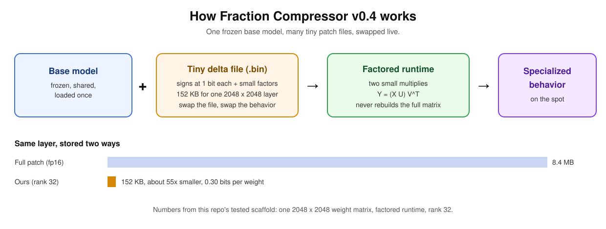

# Fraction Compressor v0.4

**One base model. Many tiny patch files. Swap a file, swap the behavior.**

What "fraction" means here: not math fractions. A fine-tuned AI model is a base model plus a patch (the weight difference between the two). This tool keeps only a fraction of that patch's information, stored at about 1 bit per weight, in a file small enough to swap in and out live.

## In plain words

A fine-tuned model differs from its base model by a patch (the delta). A normal patch is almost as big as the model itself. Fraction Compressor stores that patch in a factored form whose structure is kept as 1-bit signs, priced byte for byte by the code: 0.28 bits per weight for one large layer at rank 32 (the exact price depends on layer size and rank). v0.4 runs it through a factored runtime: two small multiplies, Y = (X U) V^T, without ever rebuilding the full weight matrix. One layer stored the normal way takes 8.4 MB; our rank-32 file takes 144 KB, and swapping patches is just loading a different small file. Compressing a patch is offline work done once with the full delta; the saving is in storage and at run time.

## Do it yourself

You need two models: a base model and a fine-tuned version of that same base, in safetensors format.

1. Make a patch from the pair (rank 32 everywhere, or pass a per-layer recipe file with `--recipe` instead of `--rank`):
   `python examples/make_patch.py --base <base-model-dir> --finetuned <finetuned-model-dir> --rank 32 --out patch.npz`
   The script subtracts the two models layer by layer, squeezes the difference into the factored format, and writes one patch file. It prints the patch's exact byte price next to the full difference at normal precision.
2. Check the patch any time:
   `python examples/make_patch.py --verify patch.npz --base <base-model-dir> --finetuned <finetuned-model-dir>`
3. Use it: load the patch together with the base model, as in `examples/hotswap_demo.py`, where patches swap in and out of one running base model live.

On the model pair used in this repo's benchmark (Qwen2.5-0.5B base and Instruct), rank 32 gives a patch priced at 19,434,496 bytes against 987,922,432 bytes for the full difference, about 51x smaller. The full run is saved at `results/make_patch_demo.txt`.

## How this is different

- **From memory files and system prompts** (the text files an AI agent reads, like a personality or memory file): those are words the model reads as instructions, they take up prompt space, and a later instruction can override them. A patch here is numbers applied to the model's own weights. The behavior changes in the math itself, uses no prompt space, and cannot be talked away.
- **From an adapter (like LoRA):** an adapter is a new add-on trained for one task, usually stored at normal precision. This tool takes a fine-tune that already exists and squeezes the difference between it and its base model into a 1-bit factored file, so an existing fine-tune becomes a small patch you can swap.
- **From shrinking a whole model (quantization):** that makes the one model smaller and slightly changes everything it does. This shrinks only the patch, so one base model stays exact and carries many behaviors, one small file each.

## Benchmark results

The benchmark compares three runs on the same questions: the base model alone, the base model with the full patch, and the base model with our compressed patch. The score is how strongly the model backs the correct answer (a log score; higher is better). "Gap closed" is the share of the base-to-full score gap that a compressed patch recovers. One limit applies everywhere below: the share of questions whose first answer token is exactly right stays low for every compressed version (about 1 to 2% on the first pair, about 8 to 9% on the second), so these are score results, not proof the model solves the tasks.

### First pair: Qwen2.5-0.5B base and Instruct

Muse Spark proposed uneven per-layer compression recipes (the Alien Sweep). The search winner, mlp_behemoth, is byte-unfair: at 21,719,776 bytes it spends 11.8% more than the human recipe's budget, so it is named only as the parent. The headline recipe is its byte-fair variant, mlp_behemoth_lite: 19,358,176 bytes, fewer than the human uniform rank-32 recipe's 19,434,496 bytes.

The check that matters is fresh questions the search never saw. That set grew from 24 to 96 questions. On all 96, lite closes 23.2% of the gap, against 2.1% for the human recipe. Lite also wins on each half alone: 9.5% vs 1.6% on the original 24 questions, and 30.4% vs 2.3% on the 72 new ones. An early read from the first small fresh set was that the lead might shrink on fresh questions; on the bigger set the lead grew instead, so that worry did not survive. Lite does not win every kind of question: on knowledge questions the human recipe closes more of the gap (7.8% vs 3.7%); lite's lead comes from the instruction and math questions.

### Second pair: SmolLM2-360M base and Instruct

The same contest ran on a second, different model pair. The search winner there (o-down supercharge) was byte-unfair too, so the byte-fair winner is its byte-matched variant, o-down-rebalanced: 19,683,328 bytes, inside the human recipe's budget of 19,705,856 bytes. On the same 96 fresh questions it beats the human uniform recipe by 0.293 score points on average, and it wins on both halves of the set separately.

One warning that applies to this pair only: every compressed version scores better than the full patch itself, so the gap-closed percentage goes above 100% here. That means the percentage is NOT a share of the fine-tune recovered for this pair. For this pair, the raw score margin (0.293 points) is the honest measure.

A third pair, Meta's own Llama 3.2 1B base and Instruct, is next; that run is waiting on Meta's license approval for the model files.

### How these numbers are checked

Every number above is produced by a script in this repo and can be rerun. Beyond the reruns, Gemini independently recomputed the arithmetic, a Muse Spark judging pass checked each headline claim against the exact result files it cites, and a Muse Glimmer reference check set the wording rules used here (which recipe may be called the leader, and how the second pair's percentage may be described). A subset of the results, picked using true quantum random numbers from IBM Quantum hardware, was re-audited end to end: 41 of 41 checks passed. The records live in `results/`.

## Built during the hackathon

This repository contains only work built during the Meta Global AI Developer Hackathon, October 26 to November 4, 2026 (Indie Developer track, Push the Frontier).

Pre-existing work (not part of this submission): Fraction Compressor v0.1 to v0.3 and the Signet delta-transfer experiments live in the original repository, [github.com/ganjikrishna/fraction-compressor](https://github.com/ganjikrishna/fraction-compressor). The compression and Signet methods were designed and validated there before the event. What is new in this repo is the factored runtime, the end-to-end task benchmark, and the Meta model comparison.

## What is in this repo

- `src/factored.py`: the factored runtime (quantize a delta, price its storage, apply it factored). Tested, see `tests/test_factored.py`.
- `examples/quickstart.py`: a 1-minute smoke run on a dummy delta (needs only numpy): prints the storage cost, bits per weight, and the factored error next to the best any factored form could do at the same rank.
- `fixtures/`: the quantum random fixture for the benchmark's audit sampling (IBM Quantum hardware, backend and job logged in the file).
- `src/bench.py` and `results/`: the end-to-end task benchmark (base vs full delta vs compressed delta) and the Alien Sweep, where Muse Spark proposed compression recipes that were scored, cross-validated (Gemini arithmetic checks, a Muse Spark judging pass, a Muse Glimmer reference check), and confirmed on 96 fresh held-out questions generated by Muse Spark, on two model pairs. See Benchmark results above.
- The live hot-swap demo: one base model loaded once, patch files swapped in live in about a tenth of a second (examples/hotswap_demo.py, transcript in results/).

## Author and credits

Built by **Vinay K Ganji Krishna**, solo participant (Indie Developer track) and author of record.

Implementation, benchmarking, and documentation were carried out with **Ember**, an AI agent powered by Muse Spark, working under the author's direction, the same way this event encourages building with Meta's Muse Code agent. Design pressure-testing also drew on a Gemini design-debate chat. Every result in this repository is produced by scripts in this repository and can be rerun.

## License

MIT, (c) 2026 Vinay K Ganji Krishna. Methods are clean-room implementations from published papers; see the original repository's NOTICE for citations.
